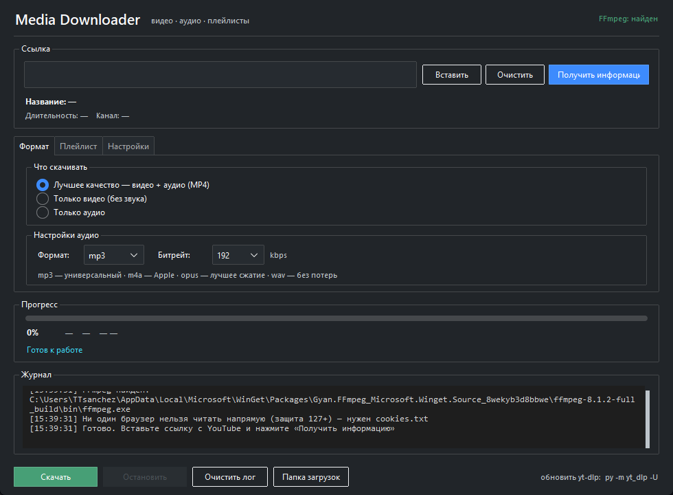
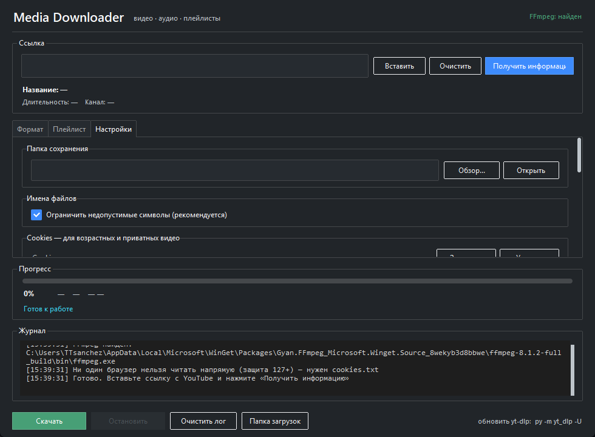
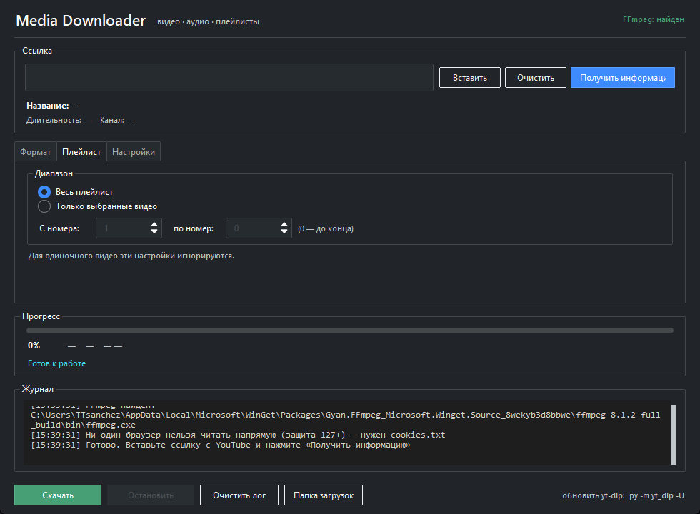

<div align="center">


# Media Downloader

**Скачивайте видео и аудио с YouTube, VK, RuTube и сотен других сайтов — в один клик. Без рекламы, лимитов и регистрации.**

[](LICENSE)
[](https://www.python.org/)
[](#-требования)
[](https://github.com/yt-dlp/yt-dlp)
[](../../releases/latest)

[Скачать](#-скачать) · [Возможности](#-возможности) · [Сайты](#-поддерживаемые-сайты) · [Как пользоваться](#-как-пользоваться) · [English](README.en.md)

</div>

---

Media Downloader — простая десктопная программа для Windows. Работает локально: ничего не отправляет на сторонние серверы, не показывает рекламу и не ограничивает количество загрузок. Внутри используется мощный движок [yt-dlp](https://github.com/yt-dlp/yt-dlp), поэтому поддерживаются сотни сайтов.



## ✨ Возможности

- 🎬 **Лучшее качество** — видео + аудио, автоматически склеенные в MP4
- 🎵 **Только аудио** — mp3, m4a, opus, wav с выбором битрейта
- 📼 **Только видео** — без звуковой дорожки
- 📚 **Плейлисты** — целиком или по диапазону номеров
- ⚡ **Shorts** и обычные ролики — одинаково просто
- 📊 **Прогресс** — процент, скорость, оставшееся время, размер файла
- ⏹ **Остановка** с корректной отменой загрузки
- 🍪 **Cookies** — для возрастных и приватных видео
- 🔁 **Автоповтор** — до 3 попыток разными способами при сбоях
- 💾 **Запоминает настройки** между запусками
- 📦 **Портативный `.exe`** — не требует установки Python

## 🌍 Поддерживаемые сайты

Благодаря yt-dlp программа работает не только с YouTube. Популярные площадки:

| Видео | Аудио и соцсети |
|---|---|
| YouTube, Shorts, VK, RuTube | SoundCloud, Bandcamp |
| Dailymotion, Vimeo, Twitch | TikTok, Instagram\*, Twitter/X |
| Одноклассники, Rutube Live | Reddit, Bilibili |

<sub>\* Некоторые сайты требуют cookies или могут быть недоступны в отдельных регионах.</sub>

Полный список — [supported sites yt-dlp](https://github.com/yt-dlp/yt-dlp/blob/master/supportedsites.md) (1000+). Поскольку yt-dlp постоянно обновляется, программа со временем поддерживает всё больше площадок.

> **Основной фокус проекта — YouTube.** Именно для него реализованы cookies, PO Token и автоповтор. Для остальных сайтов работает стандартный механизм yt-dlp.

## 📥 Скачать

### Вариант 1. Готовый .exe (проще всего)

1. Откройте страницу [**Releases**](../../releases/latest)
2. Скачайте `Media-Downloader.exe`
3. Запустите — установка не нужна

> Windows может показать предупреждение SmartScreen («Неизвестный издатель»), потому что файл не подписан цифровым сертификатом. Нажмите **«Подробнее» → «Выполнить в любом случае»**.

### Вариант 2. Из исходников

Нужен [Python 3.10+](https://www.python.org/downloads/) (при установке отметьте **Add Python to PATH**).

```bat
git clone https://github.com/TTsanchez/media-downloader.git
cd media-downloader
start.bat
```

`start.bat` сам создаст окружение, установит зависимости и откроет программу.

<details>
<summary>Запуск вручную</summary>

```bat
python -m venv venv
venv\Scripts\activate
pip install -r requirements.txt
python main.py
```
</details>

## 🚀 Как пользоваться

1. **Вставьте ссылку** на видео, аудио или плейлист в поле сверху.
2. Нажмите **«Получить информацию»** — появятся название, канал и длительность.
3. На вкладке **«Формат»** выберите, что скачивать: лучшее качество, только видео или только аудио.
4. Нажмите **«Скачать»**. Прогресс и журнал видны внизу окна.
5. Готовый файл — в папке загрузок (кнопка **«Папка загрузок»**).

<div align="center">


</div>

## 🧩 Требования

**FFmpeg обязателен** для качеств 1080p+ и конвертации в mp3/m4a/opus.

Программа ищет его в:
- системном `PATH`
- `ffmpeg\ffmpeg.exe`
- `ffmpeg\bin\ffmpeg.exe` (рядом с программой)

Если не нашла — во вкладке **«Настройки»** есть кнопка **«Скачать автоматически»**.

## 🍪 Cookies

Нужны, когда YouTube требует подтверждение «я не робот», а также для возрастных, приватных и недоступных в регионе видео.

**Способ 1 — напрямую из браузера.** «Настройки» → Cookies → выберите браузер. Список строится автоматически по установленным браузерам.

> **Важно про Chrome/Edge 127+.** Google перевёл cookies на app-bound encryption: ключ привязан к самому браузеру, и внешняя программа его не расшифрует. Поэтому такие браузеры помечены «нельзя (защита 127+)», и закрытие браузера **не помогает**. Из Firefox cookies читаются нормально.
>
> Если cookies не нужны — попробуйте скачать без них: для обычных видео это часто срабатывает.

**Способ 2 — файл cookies.txt (работает всегда).**
1. Установите в Chrome/Edge расширение **Cookie-Editor**
2. Откройте youtube.com под своим аккаунтом
3. Экспортируйте cookies в формате Netscape (`.txt`)
4. «Настройки» → Cookies → **«Загрузить»**

Данные cookies никуда не отправляются — они читаются локально и используются только для запросов к сайту.

## 🧱 Компоненты для работы с YouTube

С 2025 года YouTube требует **PO Token** и **JavaScript-челлендж**. Без них многие видео не открываются (`The page needs to be reloaded`). Программа устанавливает всё сама — вкладка **«Настройки» → «Компоненты для работы с YouTube»**.

| Компонент | Зачем | Как ставится |
|---|---|---|
| **Deno** | Выполняет проверочный JS YouTube | Кнопка «Установить Deno» (через winget) |
| **PO Token сервер** | Генерирует токены доступа | Кнопка «Установить PO Token» (нужны Node.js и Git) |

PO Token сервер — это локальная Node.js-программа [bgutil](https://github.com/Brainicism/bgutil-ytdlp-pot-provider). Она ставится один раз в `%LOCALAPPDATA%\Media-Downloader\pot` (~165 МБ), запускается сама при старте программы на `127.0.0.1:4416` и останавливается при выходе. Файлы никуда не отправляются.

> Если эти компоненты не установлены, обычные видео часто всё равно скачиваются. Они обязательны для возрастных, приватных и защищённых видео.

## 🌐 Сеть и блокировка YouTube (VPN / прокси)

В России YouTube часто блокируется провайдером **по имени домена (SNI/DPI)**: интернет работает, `google.com` открывается, а YouTube — нет. Соединение обрывается ещё до шифрования, поэтому скачать видео не может **ни одна** локальная программа — проблема не в коде.

Проверить причину: «Настройки» → **Сеть и прокси** → **«Проверить сеть»**.

- YouTube доступен напрямую — программа скачает видео сама.
- Показана «блокировка по имени домена (SNI/DPI)» — нужен **VPN** или **прокси**.

Чтобы качать через прокси, впишите его адрес в поле «Прокси» (сохраняется в конфиге):

| Пример | Описание |
|---|---|
| `http://хост:порт` | HTTP/HTTPS-прокси |
| `socks5://хост:порт` | SOCKS5-прокси |
| `http://логин:пароль@хост:порт` | Прокси с авторизацией |

Пусто — прямое подключение. Локальный PO Token сервер (`127.0.0.1`) всегда идёт мимо прокси.

### Автоповтор при сбоях

Программа делает до **3 попыток** разными способами доступа к YouTube. При сетевых ошибках, `The page needs to be reloaded`, `No video formats found` она переключается на другой способ и повторяет, а не падает сразу.

## 🛠 Если что-то не работает

| Сообщение | Причина и решение |
|---|---|
| `Connection reset` / `Connection aborted` / таймаут TLS | Сеть блокирует YouTube (SNI/DPI). Включите VPN или укажите прокси — «Настройки» → Сеть и прокси |
| `Failed to decrypt with DPAPI` | Защита cookies Chrome/Edge 127+. Нужен `cookies.txt` из Cookie-Editor |
| `Could not copy cookie database` | Браузер открыт — закройте его полностью |
| `Sign in to confirm you're not a bot` | Нужны cookies. Если не помогло — IP временно заблокирован YouTube (обычно проходит за несколько часов) |
| `The page needs to be reloaded` | Нет PO Token — установите Deno и PO Token во вкладке «Настройки» |
| `Confirm your age` | Возрастное ограничение — нужны cookies |
| `This video is private` | Нужен доступ по ссылке для приглашённых |
| `Unsupported URL` | Сайт не поддерживается или ссылка неверная. Проверьте список поддерживаемых сайтов yt-dlp |
| `Video unavailable` | Видео удалено или недоступно в вашем регионе |

## ⬆️ Обновление

Сайты периодически меняют внутреннюю защиту. Когда программа перестала работать, обновите движок:

```bat
py -m pip install -U yt-dlp
```

Если используете `.exe` — скачайте свежий релиз или пересоберите его.

## 👨‍💻 Разработка

```bat
python -m venv venv
venv\Scripts\activate
pip install -r requirements.txt
python main.py
```

Сборка одного `.exe` (результат в `dist\Media-Downloader.exe`):

```bat
build_exe.bat
```

Структура проекта:

| Файл | Назначение |
|---|---|
| `main.py` | Интерфейс (tkinter + ttkbootstrap) |
| `downloader.py` | Обёртка над yt-dlp, форматы, автоповтор |
| `utils.py` | FFmpeg, браузеры, cookies, проверка сети |
| `pot.py` | Установка и запуск PO Token сервера и Deno |

## ⚖️ Правовая заметка

Скачивание контента без разрешения правообладателя нарушает Условия использования сайтов. Используйте программу только для материалов, на которые у вас есть право: собственное видео, Creative Commons, общественное достояние или контент с явного разрешения автора.

## 📄 Лицензия

[MIT](LICENSE) © 2026 TTsanchez
